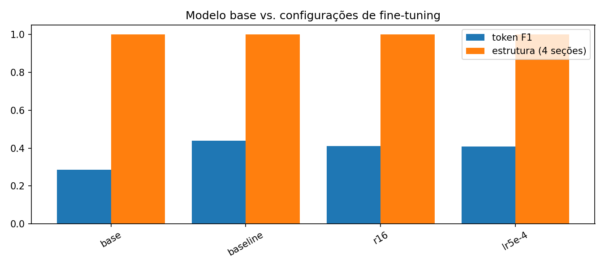
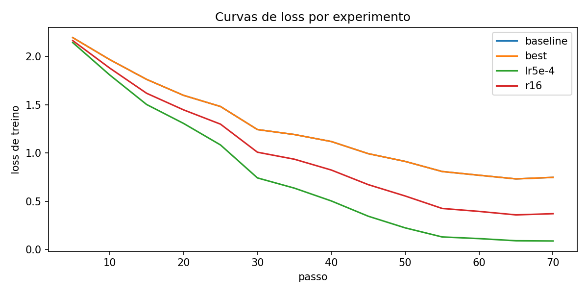

# Assistente de Manutenção Industrial com LLM local (fine-tuning LoRA em GPU)

**CP2/CP3 – Generative AI for Engineering**

> Grupo: _preencher nomes e RMs dos 4–5 integrantes_

Projeto que ajusta (fine-tuning com LoRA) um LLM open-source, **treinado e executado por nós em GPU NVIDIA** (runtime do Google Colab acessado pelo VSCode), para atuar como assistente de diagnóstico de falhas em equipamentos industriais. O usuário descreve o problema em linguagem natural e o modelo responde em um formato padronizado de quatro seções: **Causa provável, Verificações, Ação recomendada e Segurança**.

## 1. Problema escolhido

Equipes de manutenção recebem relatos informais ("o motor está esquentando e desarmando") e precisam transformá-los rapidamente em um roteiro de diagnóstico seguro e padronizado. LLMs genéricos respondem de forma longa, variável e muitas vezes sem pensar em segurança. O objetivo do fine-tuning é fazer um modelo pequeno, rodando localmente, responder **sempre em português, no formato de 4 seções, com foco em causa raiz e segurança (LOTO, NR-10, NR-12, NR-13)**.

## 2. Modelo escolhido

| Opção | Parâmetros | VRAM aprox. (treino LoRA, bf16/fp16) | Quando usar |
|---|---|---|---|
| `Qwen/Qwen2.5-0.5B-Instruct` | 0,5 B | ~3–4 GB | GPUs de 4–6 GB |
| **`Qwen/Qwen2.5-1.5B-Instruct`** (padrão) | 1,5 B | ~7–9 GB | GPUs de 8 GB ou mais |

Por que Qwen2.5-Instruct: licença aberta, bom desempenho em português para o tamanho, template de chat nativo e boa compatibilidade com Transformers/PEFT. Para trocar de modelo, use `--model` em qualquer script. Se faltar VRAM, use `--model Qwen/Qwen2.5-0.5B-Instruct`, `--batch-size 1` e/ou `--grad-ckpt`.

**Técnica:** LoRA (Low-Rank Adaptation) via biblioteca PEFT nas camadas de atenção e MLP. Só uma pequena fração dos parâmetros é treinada, o que cabe em GPUs de consumo.

## 3. Dataset

- `data/seed_examples.jsonl`: 59 pares (relato → resposta estruturada) cobrindo motores, bombas, compressores, correias, redutores, inversores, CLPs, hidráulica, pneumática, soldagem, caldeira, transformador, CNC etc.
- `src/prepare_data.py` divide em treino/validação (80/20, semente 42) e, **somente no treino**, reescreve cada relato com 4 prefixos diferentes (augmentation simples). A validação mantém os relatos originais.
- Split resultante: **47 relatos de treino (188 com augmentation) e 12 de validação**.
- **Limitação:** o conjunto é pequeno (12 exemplos de validação dão uma estimativa ruidosa). Para melhorar os resultados, o grupo pode ampliar o `seed_examples.jsonl` (meta: 100+ exemplos) mantendo o mesmo formato.

> Revisão técnica: as respostas do dataset são material didático e devem ser revisadas por um especialista antes de qualquer uso real em manutenção.

## 4. Estrutura do repositório

```
├── data/seed_examples.jsonl     # exemplos base
├── src/
│   ├── check_gpu.py             # informações da GPU + benchmark (evidência)
│   ├── prepare_data.py          # gera train/val
│   ├── common.py                # prompt, dados, carregamento e geração
│   ├── train.py                 # fine-tuning LoRA em GPU
│   ├── evaluate.py              # avaliação (F1, estrutura, velocidade)
│   ├── run_experiments.py       # teste de diferentes parâmetros
│   ├── plot_results.py          # gráficos para o relatório
│   └── app.py                   # frontend Gradio
├── notebooks/run_colab.ipynb    # roda tudo em GPU NVIDIA do Colab (para quem não tem GPU NVIDIA local)
├── results/                     # CSVs/JSONs das avaliações e experimentos
├── docs/img/                    # prints da GPU e gráficos
├── requirements.txt
└── README.md
```

## 5. Instalação (GPU + CUDA)

1. **Descubra a GPU e o driver** no terminal do VSCode: `nvidia-smi` (mostra o modelo da placa e a versão máxima de CUDA suportada pelo driver). Atualize o driver NVIDIA se estiver antigo.
2. **Escolha a versão de CUDA correta para a sua placa** no seletor oficial do PyTorch (https://pytorch.org/get-started/locally/). Como regra geral: placas RTX 50xx (Blackwell) exigem builds CUDA 12.8 ou superior; RTX 20/30/40 funcionam com CUDA 12.x. Os wheels do PyTorch já incluem as bibliotecas CUDA necessárias; o CUDA Toolkit completo só é preciso se o grupo quiser compilar extensões ou usar `nvcc`.
3. Crie o ambiente e instale (exemplo com CUDA 12.4; troque `cu124` pela versão que o seletor indicar):

```bash
python -m venv .venv
# Windows: .venv\Scripts\activate   |   Linux/macOS: source .venv/bin/activate
pip install torch --index-url https://download.pytorch.org/whl/cu124
pip install -r requirements.txt
python src/check_gpu.py      # deve mostrar "CUDA disponível: True" e o nome da GPU
```

Para o professor ver o CUDA instalado, rode também `nvcc --version` (só existe se o CUDA Toolkit estiver instalado; para o treino em si basta o driver + wheel do PyTorch com CUDA).

Observação: o primeiro uso baixa o modelo do Hugging Face (~1–3 GB).

## 6. Como executar

```bash
python src/prepare_data.py                 # gera data/train.jsonl e data/val.jsonl
python src/train.py --name baseline        # um treino (LoRA r=8, lr=2e-4, 3 épocas)
python src/evaluate.py --tag base          # avalia o modelo SEM fine-tuning
python src/evaluate.py --adapter outputs/baseline/adapter --tag baseline
python src/run_experiments.py              # bateria completa (o tempo varia conforme a GPU; anote o tempo real no relatório) de experimentos (use --quick para uma versão rápida)
python src/plot_results.py                 # gráficos em docs/img/
python src/app.py                          # frontend em http://127.0.0.1:7860
```

Todos os scripts abortam com erro se não houver GPU CUDA, garantindo que os testes foram feitos em GPU.

## 7. Parâmetros testados

Modelo `Qwen/Qwen2.5-1.5B-Instruct` com fine-tuning LoRA. Foi usada a versão rápida da bateria (`python src/run_experiments.py --quick`): a configuração de referência e duas variações de **um parâmetro por vez**, com semente fixa 42.

| Experimento | LoRA r | Learning rate | Épocas |
|---|---|---|---|
| baseline | 8 | 2e-4 | 3 |
| r16 | 16 | 2e-4 | 3 |
| lr5e-4 | 8 | 5e-4 | 3 |

Na configuração vencedora foi variada também a **temperatura de geração** (0.0, 0.3, 0.7 e 1.0, com top_p = 0.9). As demais configurações previstas no script (`r4`, `lr1e-4`, `ep5`, `ep8`) não foram executadas por limite de tempo.

## 8. Avaliação

Conjunto de validação com **12 relatos** que não foram usados no treino. Geração determinística (temperatura 0) com até 256 tokens novos. Métricas:

- **eval_loss / perplexidade** na validação (`outputs/<exp>/metrics.json`, não versionado);
- **token F1**: sobreposição de palavras entre a resposta gerada e a de referência;
- **estrutura**: fração das 4 seções obrigatórias presentes na resposta;
- **tokens/s**, **tempo de treino** e **VRAM de pico** (desempenho em GPU);
- **avaliação qualitativa**: leitura das respostas, que estão em `results/eval_<tag>.csv`.

### Resultados (execução final, NVIDIA A100 80 GB)

| Experimento | token F1 | estrutura | eval_loss | perplexidade | loss de treino | tempo de treino (s) | VRAM de pico (GB) |
|---|---|---|---|---|---|---|---|
| base (sem fine-tuning) | ⚠ ≈0,29 | ⚠ 1,00 | – | – | – | – | – |
| **baseline** (r=8, lr=2e-4, 3 ép.) | **0,4397** | 1,00 | **1,844** | **6,32** | 1,236 | 41,5 | 9,52 |
| r16 | 0,4111 | 1,00 | 2,118 | 8,32 | 0,978 | 40,3 | 9,67 |
| lr5e-4 | 0,4087 | 1,00 | 2,616 | 13,68 | 0,746 | 41,5 | 9,52 |

> ⚠ Os valores da linha "base" (F1 e estrutura) foram lidos do gráfico; o valor exato está em `results/eval_base.json` e deve substituir estes antes da entrega.

**Temperatura de geração** (adaptador baseline):

| Temperatura | token F1 | estrutura | tokens/s |
|---|---|---|---|
| **0.0** | **0,4397** | 1,00 | 13,8 |
| 0.3 | 0,4292 | 1,00 | 13,5 |
| 0.7 | 0,3939 | 1,00 | 13,1 |
| 1.0 | 0,3729 | 1,00 | 13,3 |





_Nota: a curva `best` é uma cópia da `baseline` (o script copia a melhor configuração para `outputs/best`), por isso as duas se sobrepõem._

### Execução anterior (NVIDIA Tesla T4, 14,6 GB)

A mesma bateria (`--quick`) foi executada antes em uma GPU Tesla T4, o que permite comparar o desempenho e a estabilidade dos resultados:

| Experimento | token F1 | eval_loss | tempo de treino (s) | VRAM de pico (GB) |
|---|---|---|---|---|
| base | 0,2966 | – | – | – |
| baseline | 0,4170 | 1,850 | 590 | 10,19 |
| r16 | 0,4157 | 2,115 | 594 | 10,35 |
| lr5e-4 | 0,4056 | 2,615 | 592 | 10,19 |

Evolução do eval_loss por época na T4 (do log de treino):

| Experimento | época 1 | época 2 | época 3 |
|---|---|---|---|
| baseline | 1,656 | 1,730 | 1,850 |
| r16 | 1,651 | 1,925 | 2,115 |
| lr5e-4 | 1,701 | 2,328 | 2,615 |

### Análise

**Ganho do fine-tuning.** O token F1 subiu de cerca de 0,29 (modelo base) para 0,44 (baseline), ou seja, as respostas ficaram bem mais próximas das respostas de referência. A métrica de estrutura não discrimina os modelos: o prompt de sistema já exige as 4 seções e o modelo base as segue quase sempre (na execução da T4, o base errou uma seção em uma das 12 respostas e o fine-tuned acertou todas). O ganho aparece, portanto, no conteúdo, no vocabulário técnico e na concisão (ver exemplo abaixo).

**Escolha da melhor configuração.** A baseline (r=8, lr=2e-4, 3 épocas) teve o maior F1 e o menor eval_loss nas duas execuções, e a ordenação baseline > r16 > lr5e-4 se repetiu na T4 e na A100. As margens, porém, são pequenas: a mesma configuração obteve F1 de 0,417 (T4) e 0,440 (A100), uma variação de 0,023 entre execuções com a mesma semente (precisão numérica e hardware diferentes), parecida com a diferença de 0,029 entre baseline e r16 na A100. Com apenas 12 exemplos de validação, esse resultado é um indício e não uma prova de que a baseline é a melhor.

**Overfitting.** Na A100, quanto mais agressivo o treino, menor a loss de treino (1,24 → 0,98 → 0,75) e maior o eval_loss (1,84 → 2,12 → 2,62). O log da T4 mostra o mesmo padrão por época: em todas as configurações o eval_loss é mínimo na época 1 e sobe depois. Com lr=5e-4 a loss de treino chega a 0,09 no fim, o que indica memorização do conjunto de treino (47 relatos originais). Menos épocas ou learning rate menor provavelmente generalizariam melhor (não testado).

**Temperatura.** O F1 cai de forma contínua com a temperatura (0,440 → 0,429 → 0,394 → 0,373). Para um assistente de manutenção, a geração determinística (temperatura 0) é a melhor escolha, pois dá a mesma resposta para o mesmo relato e o maior F1. Na execução da T4 a temperatura 0.3 ficou ligeiramente acima da 0.0 (0,425 contra 0,417), diferença dentro do ruído.

**Desempenho em GPU.** O treino da baseline (3 épocas, 72 passos) levou 41,5 s na A100 e 590 s na T4, cerca de 14 vezes mais rápido, usando ~9,5 a 10 GB de VRAM. Já a geração de texto foi igualmente lenta nas duas GPUs (cerca de 13,5 tokens/s com o adaptador), o que indica que, ao gerar uma resposta por vez, o gargalo não é a capacidade de cálculo da GPU. O adaptador LoRA também deixou a geração mais lenta que a do modelo base na T4 (13,5 contra 26 tokens/s); uma causa provável é o adaptador ser aplicado separadamente do modelo, e fundir os pesos (`merge_and_unload`) costuma recuperar a velocidade (não testado).

**Exemplo de resposta** (relato do conjunto de validação, nunca visto no treino):

> **Relato:** A IHM perdeu a comunicação com o CLP e mostra falha de timeout em intervalos.

**Modelo base:** expande as siglas de forma errada ("Controlador Local do Processamento" para CLP e "Interface Humana Modular" para IHM), sugere "fornecer mais energia à máquina" e a resposta é cortada no limite de 256 tokens, no meio da frase da seção de segurança.

**Modelo fine-tuned:**
```
Causa provável: cabo ou terminador desgastados, distância acima do limite ou interferência elétrica.
Verificações: medir a tensão do cabo; verificar a distância entre o PLC e a IHM; testar a conexão via jumper ou terminador separado; checar o sinal de rede.
Ação recomendada: trocar o terminador, reapertar a ligação, cortar e retutorializar o cabo e corrigir a rede de comunicação.
Segurança: desenergizar e aguardar a descarga do cabo antes de intervir na fiação; usar EPI para trabalhar perto de cabos energizados.
```

**Referência do dataset:** causa em cabo/conector, endereço IP ou escravo mal configurado e ruído na rede; verificar cabo, LEDs, ping, endereços e conflitos de IP; segurança com LOTO.

O fine-tuned respondeu de forma curta, completa e no formato pedido, e acertou a família do problema (cabo, rede, interferência), ao contrário do base. Mas também cometeu erros: usou "PLC" em vez de "CLP", inventou a palavra "retutorializar", propôs "terminador" e "descarga do cabo", que fazem pouco sentido para este caso, e não mencionou a configuração de endereços de rede nem conflitos de IP, que são causas comuns. Isso mostra que o modelo aprendeu o estilo e o vocabulário, mas não garante a correção técnica.

**Limitações e melhorias.** O dataset é pequeno (59 exemplos, 47 no treino) e a métrica F1 por tokens compara cada resposta com uma única referência, penalizando respostas corretas escritas de outra forma. Melhorias possíveis: mais exemplos revisados por profissional de manutenção; avaliação por especialista ou por um modelo juiz; várias sementes por configuração para medir a variância; testar menos épocas e as demais configurações do script; RAG com manuais técnicos. As respostas do modelo não substituem a avaliação de um técnico habilitado.

## 9. Frontend

`python src/app.py` abre uma interface Gradio onde o usuário escreve o prompt (o relato do problema), escolhe entre o **modelo base** e o **fine-tuned**, ajusta temperatura, top_p e tamanho máximo da resposta e vê a latência e a GPU em uso. No Colab, use `python src/app.py --share` para obter um link público temporário (`https://...gradio.live`).


## 10. Evidência da GPU no VSCode

Os testes foram feitos em **GPU NVIDIA com CUDA**, usando o VSCode com as extensões **Jupyter** e **Google Colab** para conectar o notebook `notebooks/run_colab.ipynb` a um runtime com GPU. A evidência é a saída de `nvidia-smi` e de `python src/check_gpu.py` dentro do próprio VSCode:

| Execução | GPU | VRAM | CUDA / PyTorch |
|---|---|---|---|
| Final | NVIDIA A100-SXM4-80GB | 79,3 GB | CUDA 13.0 / PyTorch 2.11.0+cu130 (driver 580.82.07) |
| Anterior | NVIDIA Tesla T4 | 14,6 GB | CUDA 13.0 / PyTorch 2.11.0+cu130 |

O `check_gpu.py` na A100 reportou compute capability 8.0 e uma multiplicação de matrizes 4096×4096 cerca de 429 vezes mais rápida que na CPU.


## 11. Tecnologias

Python, PyTorch (CUDA), Hugging Face Transformers, PEFT (LoRA), Gradio, pandas, matplotlib, Google Colab.